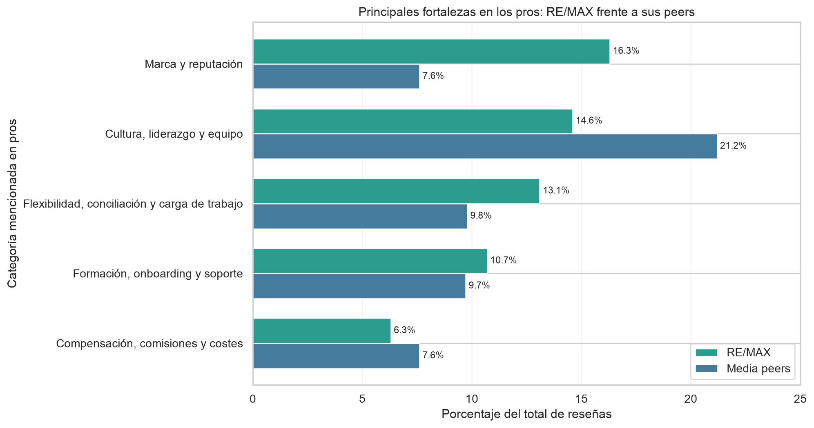
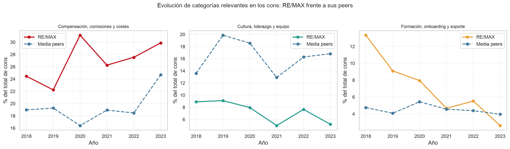
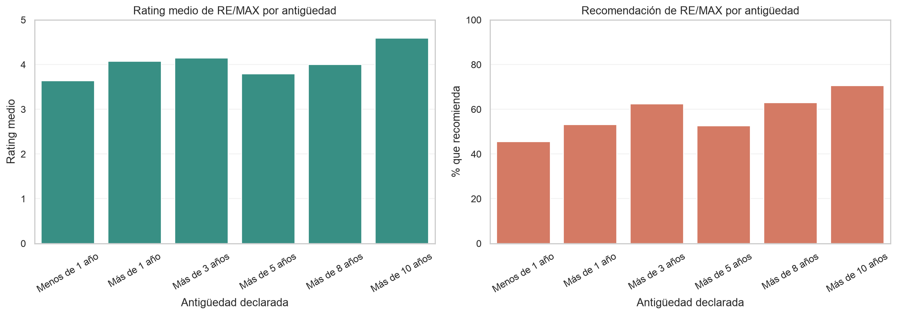
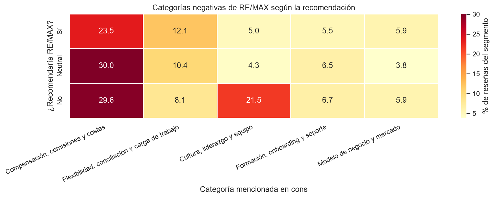

# RE/MAX Glassdoor NLP Analysis

Diagnóstico de marca empleadora y experiencia de asociados de **RE/MAX** frente a cinco empresas comparables del sector inmobiliario, realizado a partir de 5.006 reseñas de Glassdoor.

El proyecto combina análisis exploratorio, análisis de sentimiento y modelado de temas para identificar fortalezas, riesgos y áreas prioritarias de actuación para Recursos Humanos.

## Objetivo

Responder a dos preguntas de negocio:

1. ¿Qué fortalezas puede aprovechar RE/MAX para atraer y fidelizar talento?
2. ¿Qué problemas requieren una intervención prioritaria de Recursos Humanos?

La comparación incluye las siguientes empresas:

- RE/MAX
- Keller Williams
- Colliers
- Savills
- Realtor.com
- Century 21

## Metodología

El análisis se desarrolla sobre una muestra equilibrada de hasta 1.000 reseñas por empresa:

1. Preparación y exploración de los datos.
2. Comparación de rating, recomendación, evolución temporal y situación laboral.
3. Análisis de sentimiento de `pros` y `cons` con **DistilBERT**.
4. Generación de embeddings con **all-MiniLM-L6-v2**.
5. Modelado temático con **BERTopic**, UMAP y HDBSCAN.
6. Revisión y agrupación manual de los temas en 11 categorías de negocio.
7. Benchmarking de RE/MAX frente a sus peers.
8. Validación de los hallazgos mediante rating y recomendación.
9. Construcción de una matriz de priorización y recomendaciones para RR. HH.
10. Análisis complementarios de fortalezas, evolución temporal, antigüedad y segmento de recomendación.

## Principales resultados

- RE/MAX obtiene un rating medio de **4,10**, frente a **3,78** de sus peers.
- La marca y reputación constituye su principal fortaleza relativa, con una ventaja de **8,69 puntos porcentuales**.
- Flexibilidad y conciliación también destaca en los pros de RE/MAX, con un **13,1 %** frente al **9,8 %** de los peers.
- Compensación, comisiones y costes concentra el **27,2 %** de las críticas y presenta una desventaja de **9,35 puntos porcentuales** frente a los peers.
- Las personas actuales valoran su experiencia con **4,36**, frente a **3,75** entre quienes ya salieron.
- El grupo con menos de un año registra el rating más bajo (**3,64**) y un **45,5 %** de recomendación.
- Las críticas sobre compensación se mantienen por encima de los peers durante toda la serie temporal, mientras que las menciones negativas a formación y onboarding disminuyen.
- Cultura y liderazgo representa el **21,48 %** de los cons entre quienes no recomendarían RE/MAX, frente al **4,98 %** entre quienes sí la recomiendan.
- Las recomendaciones se centran en transparencia económica, seguimiento de cultura y liderazgo por oficina y un onboarding estructurado de 90 días.

## Visualizaciones destacadas

### Fortalezas mencionadas en los pros

Marca y reputación es la principal fortaleza diferencial de RE/MAX. Flexibilidad y
formación también presentan una frecuencia superior a la media de los peers. Cultura
es un atributo valorado internamente, aunque los peers lo mencionan con mayor frecuencia
en sus pros.



Resultados tabulares: [fortalezas_pros_remax_vs_peers.csv](outputs/fortalezas_pros_remax_vs_peers.csv).

### Evolución temporal de las categorías

Compensación permanece por encima de los peers como motivo de crítica durante todo el
periodo. Las menciones negativas sobre formación y onboarding, en cambio, descienden
del **13,3 % en 2018 al 2,6 % en 2023**.



Resultados tabulares: [evolucion_temporal_categorias_remax_vs_peers.csv](outputs/evolucion_temporal_categorias_remax_vs_peers.csv).

### Rating y recomendación por antigüedad

El primer año concentra la valoración más baja. La relación mejora en general con la
antigüedad, aunque el patrón no es completamente lineal y no permite establecer una
relación causal.



Resultados tabulares: [analisis_antiguedad_remax.csv](outputs/analisis_antiguedad_remax.csv).

### Categorías negativas según la recomendación

Compensación aparece de forma transversal en los tres segmentos. Cultura y liderazgo
se concentra especialmente entre quienes no recomendarían RE/MAX, donde representa el
**21,5 %** de las críticas.



Resultados tabulares: [segmentacion_recomendacion_remax.csv](outputs/segmentacion_recomendacion_remax.csv).

## Estructura del proyecto

```text
.
├── data/raw/              # Archivos de entrada locales
├── docs/                  # Enunciado y presentación ejecutiva
├── imagenes/              # Visualizaciones exportadas
├── models/                # Embeddings y artefactos locales no versionados
├── notebooks/
│   └── analisis_remax_glassdoor.ipynb
├── outputs/               # Resultados agregados en CSV
├── .python-version
├── requirements.txt
└── README.md
```

## Instalación local

El entorno utilizado fue validado con **Python 3.12.13**.

```bash
git clone https://github.com/JOBdeini/remax-glassdoor-nlp-analysis.git
cd remax-glassdoor-nlp-analysis

python3.12 -m venv .venv
source .venv/bin/activate
python -m pip install --upgrade pip
pip install -r requirements.txt
```

Para registrar el entorno como kernel de Jupyter:

```bash
python -m ipykernel install --user \
  --name proyecto-modular-nlp \
  --display-name "Python 3.12 - RE/MAX NLP (.venv)"
```

## Datos

El dataset `glassdoor_reviews_hr.parquet` no se incluye en el repositorio debido a su tamaño y a las condiciones de distribución del material académico.

Como referencia del origen de las recopilaciones de reseñas de Glassdoor utilizadas en
el material académico, se citan los datasets publicados por **Gauthier, D.** en Kaggle.

Para ejecutar el análisis, debe colocarse en:

```text
data/raw/glassdoor_reviews_hr.parquet
```

El notebook también admite el archivo en la raíz del proyecto o subido directamente al entorno de Google Colab.

## Ejecución

```bash
jupyter lab
```

Abrir y ejecutar:

```text
notebooks/analisis_remax_glassdoor.ipynb
```

El notebook guarda las visualizaciones en `imagenes/` y los resultados tabulares en `outputs/`.

## Presentación ejecutiva

La presentación con el planteamiento, la metodología, los resultados y las recomendaciones se encuentra en:

[docs/presentacion-remax-analisis-asociados.pdf](docs/presentacion-remax-analisis-asociados.pdf)

La versión completa del notebook en PDF, con código, explicaciones y resultados ejecutados, está disponible en:

[docs/analisis-remax-glassdoor-notebook.pdf](docs/analisis-remax-glassdoor-notebook.pdf)

## Limitaciones

- Las reseñas son voluntarias y pueden presentar sesgo de autoselección.
- La muestra combina países, oficinas, funciones y modelos de relación laboral diferentes.
- La fecha de publicación no siempre coincide con el periodo exacto de la experiencia descrita.
- La agrupación de temas en categorías de negocio incorpora revisión y criterio manual.
- Los resultados muestran asociaciones y no permiten establecer causalidad individual.

## Referencias y recursos

- Gauthier, D. *Glassdoor Job Reviews* [dataset]. [Kaggle](https://www.kaggle.com/datasets/davidgauthier/glassdoor-job-reviews).
- Gauthier, D. *Glassdoor Job Reviews 2* [dataset]. [Kaggle](https://www.kaggle.com/datasets/davidgauthier/glassdoor-job-reviews-2).
- Gauthier, D. [Perfil y referencia académica en Google Scholar](https://scholar.google.com/citations?view_op=view_citation&hl=en&user=FQstpaoAAAAJ&citation_for_view=FQstpaoAAAAJ:UebtZRa9Y70C).

## Autor

**Job Delgado Iniesta**  
Proyecto modular de Deep Learning y NLP.
